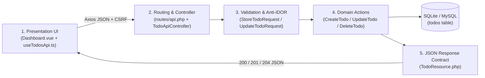
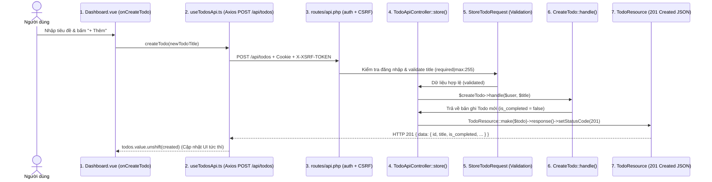

# TodoApp — Laravel 13 + Vue 3.5 + Axios REST API (5-Layer Clean Architecture)

Ứng dụng quản lý công việc (**TodoApp**) xây dựng theo kiến trúc **5-Layer Clean Architecture** kết hợp **Laravel 13**, **Vue 3.5 (`<script setup lang="ts">`)**, **Axios REST API** và **Tailwind CSS v4** — tối ưu trải nghiệm không tải lại trang (Zero-Reload SPA), bảo mật chống leo thang đặc quyền (**Anti-IDOR/BOLA**), và kiểm thử tự động **Pest v4**.

- **Repository**: [https://github.com/nguynbon03/TodoApp](https://github.com/nguynbon03/TodoApp)

---

## 1. Tổng Quan Kiến Trúc (5-Layer Clean Architecture)

Hệ thống được phân tách rõ ràng thành **5 tầng độc lập (Single Responsibility)**, giúp dễ đọc, dễ bảo trì và mở rộng cho cả Web lẫn Mobile App:



| Tầng | Thành phần cốt lõi | Vai trò & Trách nhiệm |
|---|---|---|
| **1. Frontend (Vue 3.5 + Composable)** | [`resources/js/pages/Dashboard.vue`](resources/js/pages/Dashboard.vue)<br>[`resources/js/composables/useTodosApi.ts`](resources/js/composables/useTodosApi.ts) | Giao diện người dùng sử dụng `<script setup lang="ts">`, quản lý trạng thái 4-State FSM (`Idle -> Loading -> Success/Error`), bộ lọc (`Tất cả`, `Đang làm`, `Đã xong`), thống kê tiến độ và gọi REST API qua Axios. |
| **2. Routing & Controller** | [`routes/api.php`](routes/api.php)<br>[`routes/web.php`](routes/web.php)<br>[`app/Http/Controllers/Api/TodoApiController.php`](app/Http/Controllers/Api/TodoApiController.php) | Định tuyến `GET/POST/PATCH/DELETE /api/todos` bọc trong middleware `web` + `auth` (bảo vệ bằng Session Cookie + `X-XSRF-TOKEN` CSRF) và render khung trang tại [`routes/web.php`](routes/web.php). |
| **3. Validation & Anti-IDOR Guard** | [`app/Http/Requests/Todos/StoreTodoRequest.php`](app/Http/Requests/Todos/StoreTodoRequest.php)<br>[`app/Http/Requests/Todos/UpdateTodoRequest.php`](app/Http/Requests/Todos/UpdateTodoRequest.php) | Kiểm duyệt dữ liệu đầu vào (`title` bắt buộc, tối đa `255` ký tự) và **chặn lỗ hổng IDOR/BOLA** ngay tại `authorize()`: `$todo->user_id === $this->user()?->id` (trả `403 Forbidden` nếu sửa/xóa việc của người khác). |
| **4. Domain Actions** | [`app/Actions/Todos/CreateTodo.php`](app/Actions/Todos/CreateTodo.php)<br>[`app/Actions/Todos/UpdateTodo.php`](app/Actions/Todos/UpdateTodo.php)<br>[`app/Actions/Todos/DeleteTodo.php`](app/Actions/Todos/DeleteTodo.php) | Các class thực thi nghiệp vụ đơn nhiệm (Single-Action Classes), tách biệt hoàn toàn logic ghi/sửa/xóa Database khỏi Controller. |
| **5. JSON Response Contract** | [`app/Http/Resources/TodoResource.php`](app/Http/Resources/TodoResource.php) | Chuẩn hóa cấu trúc JSON trả về (`id`, `title`, `is_completed`, `created_at`, `updated_at`), tuyệt đối không lộ khóa ngoại `user_id` ra phía trình duyệt. |

---

## 2. 6 Bước Cầm Tay Chỉ Việc Chạy Dự Án Từ Con Số 0

### Bước 1: Yêu cầu môi trường & Tải mã nguồn (`git clone`)

Đảm bảo máy tính đã cài đặt sẵn:
- **PHP**: `>= 8.3` (kèm extension `pdo_sqlite`, `mbstring`, `xml`, `ctype`, `json`)
- **Composer**: `>= 2.7`
- **Node.js**: `>= 20.x` & **NPM**

Mở Terminal và tải mã nguồn về máy:

```bash
git clone https://github.com/nguynbon03/TodoApp.git && cd TodoApp
```

---

### Bước 2: Cài đặt thư viện & Khởi tạo cấu hình `.env` + SQLite

Chạy chuỗi lệnh dưới đây để cài đặt các gói PHP/JS, sao chép file môi trường `.env` từ `.env.example` (giữ bí mật `APP_KEY` và cấu hình cục bộ nằm trong `.gitignore`), tạo khóa ứng dụng và khởi tạo bảng dữ liệu SQLite:

```bash
composer install && npm install && cp .env.example .env && php artisan key:generate && touch database/database.sqlite && php artisan migrate
```

> **Lưu ý bảo mật**: File `.env` chứa thông tin nhạy cảm (`APP_KEY`, thông tin kết nối DB/API) đã được đưa vào `.gitignore`. Khi cấu hình môi trường mới, luôn sao chép từ `.env.example` và không bao giờ commit `.env` lên Git.

---

### Bước 3: Khởi chạy dự án bằng 1 lệnh duy nhất

Khởi động toàn bộ hệ thống (PHP Server `:8000`, Queue Worker, Pail Logs và Vite HMR `:5173`) chỉ với 1 lệnh:

```bash
composer run dev
```

- Mở trình duyệt truy cập: **[http://127.0.0.1:8000](http://127.0.0.1:8000)**
- Đăng ký tài khoản mới tại `/register` hoặc đăng nhập tại `/login` để vào thẳng trang **Dashboard** (`/dashboard`) quản lý công việc.

---

### Bước 4: Giải phẫu luồng hoạt động 7 trạm khi bấm `+ Thêm`

Khi bạn nhập tên công việc vào ô input và bấm nút **`+ Thêm`**, dữ liệu đi qua đúng **7 trạm kiểm soát chuẩn Clean Architecture** mà không cần tải lại trang:



1. **Trạm 1 (`onCreateTodo` tại [`Dashboard.vue`](resources/js/pages/Dashboard.vue))**: Bắt sự kiện `@submit.prevent="onCreateTodo"`, kiểm tra chuỗi không rỗng và khóa nút bấm (`submitting = true`) chống bấm đúp.
2. **Trạm 2 (`createTodo` tại [`useTodosApi.ts`](resources/js/composables/useTodosApi.ts))**: Gửi request `axios.post('/api/todos', { title })` kèm header `Accept: application/json` và `X-Requested-With: XMLHttpRequest`.
3. **Trạm 3 (Middleware tại [`routes/api.php`](routes/api.php))**: Xác thực phiên đăng nhập qua Session Cookie và kiểm tra `X-XSRF-TOKEN` chống tấn công CSRF.
4. **Trạm 4 ([`StoreTodoRequest.php`](app/Http/Requests/Todos/StoreTodoRequest.php))**: Kiểm tra `authorize()` và luật `title: ['required', 'string', 'max:255']`. Nếu để trống hoặc quá 255 ký tự, trả ngay `422 Unprocessable Entity` kèm thông báo lỗi tiếng Việt.
5. **Trạm 5 ([`TodoApiController.php`](app/Http/Controllers/Api/TodoApiController.php))**: Điều phối request đã hợp lệ sang tầng Action mà không ôm logic xử lý DB trong Controller.
6. **Trạm 6 ([`CreateTodo.php`](app/Actions/Todos/CreateTodo.php))**: Tạo bản ghi mới thông qua quan hệ `$user->todos()->create(['title' => $title, 'is_completed' => false])`.
7. **Trạm 7 ([`TodoResource.php`](app/Http/Resources/TodoResource.php))**: Đóng gói bản ghi thành chuẩn `{ data: { id, title, is_completed, created_at, updated_at } }` với mã `201 Created`, giúp Vue chèn ngay lên đầu danh sách (`todos.value.unshift(created)`).

---

### Bước 5: Chạy bộ kiểm thử tự động Pest & Kiểm tra kiểu TypeScript

Dự án đi kèm bộ kiểm thử tự động bao phủ toàn bộ luồng CRUD, Validation và chống leo thang đặc quyền (Anti-IDOR):

```bash
# 1. Chạy 15 kịch bản kiểm thử Feature cho TodoApp (15/15 PASS, 99 assertions)
php artisan test --compact tests/Feature/TodoCrudTest.php

# 2. Kiểm tra tính toàn vẹn kiểu dữ liệu TypeScript trên toàn bộ Frontend Vue
npx vue-tsc --noEmit
```

**Danh mục kiểm thử trong [`tests/Feature/TodoCrudTest.php`](tests/Feature/TodoCrudTest.php)**:
- Chặn người dùng chưa đăng nhập (`302 Redirect` trên Web, `401 Unauthorized` trên `/api/todos`).
- Hiển thị đúng danh sách công việc của chính người dùng đang đăng nhập (cô lập dữ liệu đa người dùng).
- Tạo mới, đổi trạng thái hoàn thành (`is_completed`), sửa tiêu đề và xóa công việc qua cả REST API (`/api/todos`) lẫn Web/Inertia (`/todos`).
- Kiểm tra lỗi `422` khi tiêu đề rỗng hoặc vượt quá 255 ký tự.
- Kiểm tra bảo mật **Anti-IDOR (`403 Forbidden`)** khi người dùng A cố tình gửi `PATCH` hoặc `DELETE` vào ID công việc của người dùng B.

---

### Bước 6: Mở rộng & Triển khai thực tế (Cloudflare Tunnel / VPS)

#### Phương án A: Chia sẻ nhanh qua HTTPS bằng Cloudflare Tunnel (Không cần mở Port Router)
1. Build tài nguyên Frontend tối ưu cho môi trường chạy thật:
   ```bash
   npm run build
   ```
2. Khởi chạy PHP Server cục bộ ở cổng `8000`:
   ```bash
   php artisan serve --host=127.0.0.1 --port=8000
   ```
3. Mở một cửa sổ Terminal thứ hai và bật `cloudflared` để tạo đường hầm HTTPS miễn phí:
   ```bash
   cloudflared tunnel --url http://127.0.0.1:8000
   ```

#### Phương án B: Triển khai 24/7 trên VPS (Ubuntu + Nginx + PHP-FPM / Systemd)
1. Trên VPS, thiết lập `.env` sang chế độ Production:
   ```env
   APP_ENV=production
   APP_DEBUG=false
   APP_URL=https://todo.ten-mien-cua-ban.com
   ```
2. Chạy lệnh tối ưu hóa bộ nhớ đệm của Laravel và biên dịch giao diện:
   ```bash
   composer install --no-dev --optimize-autoloader
   npm ci && npm run build
   php artisan migrate --force
   php artisan config:cache && php artisan route:cache && php artisan view:cache
   ```
3. Cấu hình Nginx trỏ `root` vào thư mục `/var/www/TodoApp/public` và sử dụng `php8.3-fpm` hoặc quản lý tiến trình tự khởi động lại 24/7 qua `systemd` / `supervisor`.
